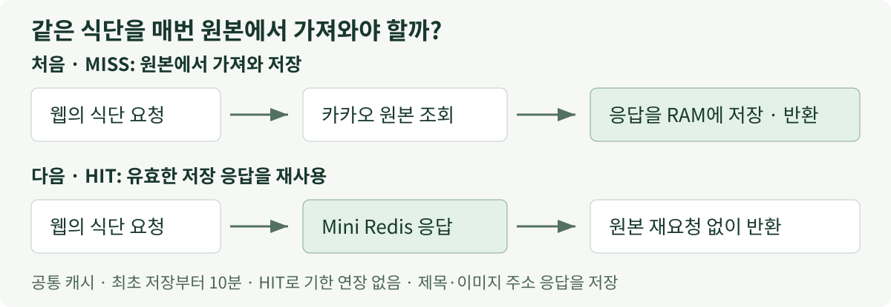
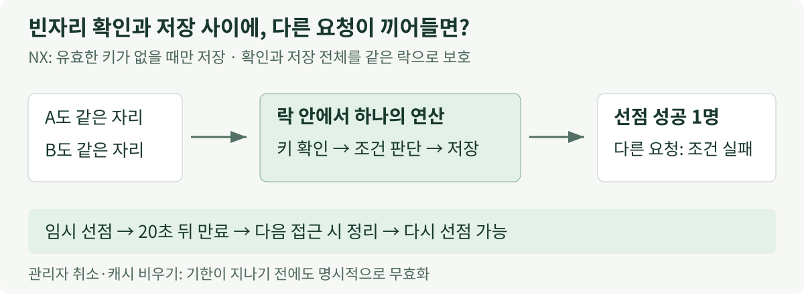
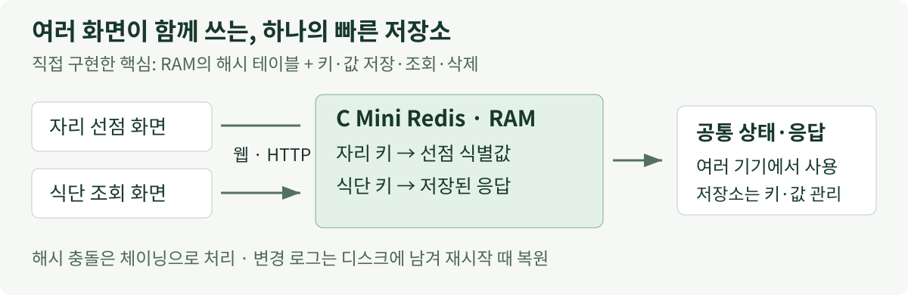

<!-- PROJECT_OVERVIEW -->
# Mini Redis

C로 구현한 **인메모리 키·값 저장소**입니다. **RAM에 보관한 데이터를 읽고 갱신**하며, 저장한 API 응답을 재사용하는 **캐시**로 활용했습니다.

| 핵심 개념 | 이번 구현에서의 의미 |
| --- | --- |
| **인메모리** — 어디에 보관하나? | 실제 키·값을 RAM의 해시 테이블에 보관하고 조회·갱신 |
| **캐시** — 어떻게 활용하나? | 식단 API 응답을 저장해 다음 요청에서 원본 조회를 생략 |

## 구현 내용

| 기능 | 직접 구현한 내용 | 선택 이유 |
| --- | --- | --- |
| 키·값 저장 | 해시 함수, 체이닝, 리해싱, 저장·조회·삭제 | 충돌과 데이터 증가를 처리하는 범용 저장소 |
| 만료·무효화 | 접근 시 TTL 확인, 명시적 삭제, 식별값 비교 후 변경·삭제 | 만료된 값과 오래된 요청을 안전하게 처리 |
| 동시성 제어·선점 | NX 조건과 저장소 전체의 공통 락(mutex) | 키 확인과 저장 사이에 다른 요청이 끼어들지 않게 보호 |
| 재시작 복원 | AOF 방식의 변경 로그, 디스크 반영 후 성공 응답, 재시작 시 로그 재적용 | 성공 처리한 변경을 재시작 후에도 복원 |
| 외부 연동 | HTTP JSON API로 저장·조회·삭제·조건부 연산 제공 | 별도 프로그램이 같은 저장소를 사용 |

## 핵심 설계와 고려한 점

### 동시성 제어 — 공통 락

- **설계:** NX의 조회 → 만료 확인 → 조건 판단 → 저장을 하나의 락(mutex)으로 보호
- **이유:** 확인과 저장 사이에 다른 요청이 끼어드는 문제 방지
- **적용 범위:** 일반 저장·조회·삭제도 같은 락 사용
- **한계:** 서로 다른 키의 작업도 순서대로 처리

### 데이터 유효성 — 만료와 조건부 변경

- **설계:** 접근 시 만료된 값을 없는 것으로 처리하고 메모리에서 제거
- **보호:** 식별값이 일치할 때만 변경·삭제하여 이전 선점자의 늦은 요청 차단
- **한계:** 접근하지 않는 만료 항목은 메모리에 남을 수 있음

### 재시작 복원 — AOF 방식

- **순서:** 로그 기록 → 디스크 반영(`fsync`) → RAM 반영 → 성공 응답
- **이유:** 주기적인 스냅샷 사이의 변경 유실을 줄이고 재시작 시 복원
- **한계:** 변경마다 디스크 반영을 기다리는 비용 발생
- **형식:** 자체 로그 형식 사용 — 실제 Redis AOF와는 호환되지 않음

아래 두 사례는 이 저장소의 활용과 검증입니다. **식단 캐시는 반복 조회 비용을 줄이는지**, **자리 선점은 공유 상태를 안전하게 변경하는지**를 확인합니다. 자리 예약 자체의 규칙은 웹 서버가 담당하고, 미니 Redis는 키·값과 조건을 처리합니다.

## 캐시 활용 — 같은 응답의 재사용

**첫 요청은 원본에서 가져와 저장하고(MISS), 이후 요청은 유효한 저장 응답을 재사용합니다(HIT).** 캐시 값은 식단 제목·이미지 주소 등이며 이미지 파일 자체는 아닙니다.



| 원본 조회 중앙값 | 캐시 조회 중앙값 |
| --- | --- |
| **39.651 ms** | **0.418 ms** |

동일 응답 각 5회의 웹 서버 내부 처리 시간입니다(2026-11-14). 브라우저 왕복·이미지 다운로드는 제외했습니다. [측정 원본](docs/menu-benchmark.json)

## 공유 상태 활용 — 자리 선점과 만료

**NX는 유효한 키가 없을 때만 저장합니다.** 만료 확인·조건 판단·저장을 같은 락 안에서 처리하고, 임시 선점은 20초 동안 유효하게 둡니다.



**만료와 무효화는 구분합니다.** TTL이 지난 값은 접근할 때 없는 것으로 처리하고 메모리에서 제거합니다. 관리자 배정 취소와 캐시 비우기는 기한 전에도 명시적으로 삭제하는 무효화입니다.

## 검증 결과

| 검증 대상 | 확인한 내용 |
| --- | --- |
| 기본 연산 | 키·값 저장·조회·삭제 단위 테스트 |
| 동시성 | 동시 NX 요청 100개 중 유효한 선점 1개 성공 |
| 엣지 케이스 | 만료 경계, 없는 키, 충돌·리해싱, 오래된 요청, 할당·쓰기·동기화 실패 |
| 외부 사용·캐시 | HTTP·웹 기능 테스트, API 응답 저장·공유·만료·삭제 후 재조회 |
| 복원·메모리 | 로그 복원·손상 처리, ASan/UBSan 검사 |

총 **62개 테스트 묶음·케이스**를 검증했습니다. 같은 테스트를 일반 빌드와 검사 빌드에서 반복한 횟수는 중복 계산하지 않았습니다.

| 구분 | 개수 | 검증 환경 |
| --- | ---: | --- |
| 저장소 핵심 연산 | 19 | 일반 빌드 · ASan/UBSan 빌드 |
| AOF 방식 로그·복원 | 9 | 일반 빌드 · ASan/UBSan 빌드 |
| HTTP API | 8 | 일반 빌드 · ASan/UBSan 빌드 |
| 자리 예약 웹 연동 | 19 | Python 기능 테스트 · 실제 C 서버 |
| 식단 캐시 연동 | 7 | Python 기능 테스트 · 실제 C 서버, 원본 응답 대체 |

---

<details>
<summary><strong>실행 방법 · 구조 · 해시 테이블 · API · 변경 로그 · 상세 검증과 한계</strong></summary>

### 전체 구조




## 개발 환경

Windows의 프로젝트 폴더를 VS Code에서 열고, Docker 안의 Ubuntu 22.04에서
C 코드를 컴파일하고 실행합니다. 완성된 Redis를 실행하는 `mini-redis`
컨테이너와 이 개발 환경은 별개입니다.

1. Docker Desktop을 실행하고 엔진이 준비될 때까지 기다립니다.
2. VS Code에서 이 `Mini_Redis` 폴더를 엽니다.
3. `Ctrl+Shift+P`에서 `Dev Containers: Reopen in Container`를 실행합니다.
4. 처음에는 이미지 다운로드와 개발 도구 설치가 진행됩니다.
5. 연결 후 새 터미널을 열어 아래 명령으로 도구를 확인합니다.

```bash
gcc --version
make --version
gdb --version
pwd
```

개발 환경 설정은 `.devcontainer/Dockerfile`과
`.devcontainer/devcontainer.json`에 있습니다.
현재 HTTP API는 libmicrohttpd·cJSON을 사용하며 저장소8080, 웹8090으로 실행합니다.

## 1단계: 해시 테이블

Dev Container 터미널의 `/workspaces/Mini_Redis`에서 실행합니다.

```bash
make test
make sanitize
```

`make test`는 저장·조회·수정, 없는 키와 빈 값, 키·값 복사본의 수명,
충돌 리스트의 앞·중간·끝 삭제, 자동 확장, 잘못된 인자,
메모리 할당 실패 시 기존 데이터 보존을 검사합니다.
`make sanitize`는 같은 테스트에 AddressSanitizer와 UndefinedBehaviorSanitizer를
적용하고 메모리 누수도 검사합니다. 이 테스트는 GCC/GNU 링커 환경을 사용합니다.

| 파일 | 역할 |
| --- | --- |
| `include/hash_table.h` | 자료구조와 함수 선언, 반환 상태, 메모리 소유권 계약 |
| `src/hash_table.c` | FNV-1a, 체이닝, 저장·조회·삭제, 자동 확장 |
| `tests/test_hash_table.c` | 정상·충돌·실패 상황 테스트 |

사용 예시는 다음과 같습니다.

```c
#include "hash_table.h"
#include <stdlib.h>

hash_table table;
if (ht_init(&table) == HT_OK) {
    if (ht_set(&table, "seat:A1", "reservation-123") == HT_OK) {
        char *value = NULL;
        if (ht_get(&table, "seat:A1", &value) == HT_OK) {
            /* value는 호출자가 소유하는 복사본입니다. */
            free(value);
        }
    }
    ht_destroy(&table);
}
```

테이블은 초기화 후 사용하고 종료 시 해제합니다. 초기화된 테이블을 구조체
대입으로 복사하거나 필드를 직접 수정하지 않습니다. 문자열은 NUL로 끝나는
C 문자열이며, 빈 문자열은 허용하지만 NULL 인자와 내장 NUL 데이터는 지원하지 않습니다.

## 2단계: 만료 처리

노드의 `expires_at_ms`에는 Unix 기준 밀리초 만료 시각을 저장합니다.
0은 만료 없음을 의미합니다. 시간 조회는 서버의 `CLOCK_REALTIME`을 사용합니다.

```c
/* 지금부터 20초 동안 유효합니다. */
ht_set_ttl(&table, "seat:A1", "reservation-123", 20000);

/* 절대 시각 지정: deadline_ms는 Unix 기준 밀리초입니다. */
ht_set_until(&table, "seat:A1", "reservation-123", deadline_ms);
```

- 현재 시각이 만료 시각 이상이면 해당 키는 없는 것으로 처리합니다.
- 조회·저장·삭제에서 해당 키를 찾을 때 만료된 노드를 제거합니다.
- `ht_get`도 테이블을 변경할 수 있으므로 더 이상 const 테이블을 받지 않습니다.
- 만료된 키를 삭제하면 이미 없는 키이므로 `HT_NOT_FOUND`를 반환합니다.
- 일반 `ht_set`으로 덮어쓰면 기존 만료를 해제합니다.
- TTL은 양수만 허용하고, 절대 시각은 0 또는 양수를 허용합니다.
  과거 절대 시각으로 저장한 값은 다음 접근 때 만료로 처리됩니다.
- 잘못된 시간·덧셈 오버플로는 `HT_INVALID_ARGUMENT`,
  서버 시계 읽기 실패는 `HT_CLOCK_ERROR`로 구분합니다.
- 접근하지 않은 만료 노드는 메모리에 남고 물리적 `size`에 포함됩니다.
  확장할 때 전체 만료 항목을 청소하지는 않습니다.
- 절대 시각을 사용하므로 서버 시스템 시각 조정은 만료 판단에 영향을 줍니다.

추가한 테스트는 실제로 기다리지 않고 테스트 시계를 고정해
만료 직전·정각·이후, 지연 삭제, 재저장, 충돌 노드 제거, 확장 후 만료 유지,
할당 실패 시 기존 기한 보존, 잘못된 TTL과 시계 오류를 검사합니다.
`make test`와 `make sanitize`로 기존 7개와 만료 4개 묶음을 함께 실행합니다.

## 3단계: NX와 공통 락

```c
/* 유효한 선점이 없을 때만 20초 저장합니다. */
ht_status result = ht_set_nx(&table, "seat:A1", "reservation-123", 20000);
/* HT_OK: 성공, HT_CONDITION_NOT_MET: 이미 유효한 키가 있음 */
```

`ht_set_nx`에서 TTL 0은 무기한, 양수는 밀리초 유효기간입니다.
이미 유효한 키가 있으면 기존 값·만료 시각은 바꾸지 않습니다.
만료된 키는 제거한 뒤 선점할 수 있고, 음수 TTL은 잘못된 요청입니다.

모든 공개 데이터 연산은 테이블의 공통 mutex 하나로 보호합니다.
NX의 만료 확인·조건 판단·저장뿐 아니라, 일반 저장·조회 복사·삭제·리해싱도
같은 락 안에서 처리합니다. 내부 `_locked` 함수는 락을 다시 잡지 않습니다.
공개 함수는 작업 결과가 오류여도 획득한 락을 해제하고 반환합니다.
뮤텍스 초기화·획득·해제 실패는 `HT_LOCK_ERROR`로 구분합니다.

테이블 초기화와 해제는 다른 호출이 모두 끝난 상태에서 수행해야 합니다.
구조체 복사와 필드 직접 수정은 금지하고, 필드 관찰도 동시 작업이 없을 때만 합니다.
공통 락은 FIFO 예약 순서나 먼저 클릭한 사람의 우선권을 보장하지 않습니다.

`make test`와 `make sanitize`는 이제 14개 테스트 묶음을 실행합니다.
추가 검증은 NX 조건·만료·오류, 100개 동시 선점 중 정확히 하나 성공,
8개 스레드의 혼합 저장·조회·삭제 및 리해싱입니다.
메모리 검사와 동시성 시나리오 테스트이며, 모든 스케줄에 대한 수학적 증명은 아닙니다.

## 4단계: 조건부 삭제와 조건부 변경

```c
/* 현재 값이 이번 선점 ID와 일치할 때만 취소합니다. */
ht_compare_delete(&table, "seat:A1", "reservation-123");

/* 현재 값이 임시 선점과 같을 때만 확정 값과 공통 리셋 시각으로 바꿉니다. */
ht_compare_set_until(&table, "seat:A1", "reservation-123",
                     "confirmed:reservation-123", reset_at_ms);
```

키가 없거나 만료됐다면 `HT_NOT_FOUND`, 현재 값이 다르면
`HT_CONDITION_NOT_MET`를 반환합니다. 조건부 변경은 없는 키를 생성하지 않습니다.
전체 문자열이 일치해야 하며, 사용자 인증·권한 확인을 대신하지 않습니다.
웹 서버가 요청에 맞는 현재 선점 값을 지정해야 합니다.

만료 확인·비교·실제 삭제/변경 전체를 공통 락으로 보호합니다.
내부에서는 공개 함수를 다시 호출해 락을 중복 획득하지 않습니다.
값 변경의 할당 실패 시 기존 값과 기한은 유지하고, 항목 수도 그대로입니다.
새 만료 시각은 `ht_set_until`과 동일하게 0(무기한) 또는 양수 Unix 밀리초입니다.

전체 테스트는 19개 묶음입니다. 오래된 ID로 새 선점을 취소·확정하지 못하는지,
만료된 선점이 확정으로 되살아나지 않는지, 100개 조건부 변경 중 하나만 성공하는지,
취소·확정의 동시 요청에서도 일관된 결과가 나오는지 확인합니다.

## 5단계: 변경 로그와 재시작 복원

`ht_init`는 메모리 전용, `ht_open`은 파일 복원을 사용하는 초기화입니다.
같은 테이블에 두 함수를 연달아 호출하지 않습니다.

```c
/* 먼저 부모 디렉터리 data를 생성해야 합니다. */
hash_table table;
if (ht_open(&table, "data/mini-redis.aof") == HT_OK) {
    ht_set(&table, "seat:A1", "confirmed:reservation-123");
    ht_destroy(&table);
}
/* 다음 실행에서 같은 파일을 ht_open하면 데이터를 복원합니다. */
```

실제 사용 시 각 저장 연산의 반환값도 확인해야 합니다. `data`를 프로젝트 폴더
안에 두면 Dev Container 교체 후에도 Windows에 마운트된 파일이 남습니다.
현재 기본 테스트는 `/tmp`의 임시 파일을 생성·정리하므로 실제 배정 파일을 건드리지 않습니다.

변경 시 공통 락 안에서 필요한 메모리와 확장 공간을 준비하고,
SET/DELETE 결과를 기록해 `fsync`가 성공하면 메모리를 변경합니다.
키·값·절대 만료 시각을 기록하므로 재시작 시 NX나 선점 조건을 다시 판단하지 않습니다.
지연 만료 정리는 로그에 추가하지 않으며 원래 만료 시각으로 처리합니다.

로그는 길이가 있는 binary 기록이며 헤더와 본문을 각각 체크섬으로 확인합니다.
문자열의 줄바꿈·따옴표도 저장 가능하고, 한 기록의 키+값은 최대 1MiB입니다.
불완전한 마지막 기록은 제거하고 파일을 동기화한 뒤 이어 씁니다.
완전한 기록의 손상은 `HT_CORRUPT_LOG`로 시작을 거부하고 파일을 그대로 보존합니다.
체크섬은 우발적인 손상 검사이며 악의적 변조에 대한 인증은 아닙니다.
동일 파일은 OS 파일 잠금으로 하나의 저장소만 열 수 있습니다.

기록·디스크 동기화 오류는 `HT_IO_ERROR`입니다. 그 실행에서는 후속 변경을 차단하고
읽기는 유지합니다. 성공 응답을 하지 않았더라도, 완전히 기록된 변경은 재시작 후
복원될 수 있으므로 실패 응답을 과거 변경의 확정적 취소로 해석하면 안 됩니다.
원인을 해결하고 파일을 검증해 재시작해야 합니다.

복원은 전체 기록 재현 → 최종 만료 항목 제거 순서로 수행하며 기록을 재생성하지 않습니다.
로그 자동 압축·회전은 아직 없어 파일과 복원 시간이 계속 커질 수 있습니다.

테스트는 기존 19개와 영속성 9개, 총 28개 묶음입니다.
정상 복원, 만료·삭제·조건부 결과 재현, 꼬리 복구, 손상 거부,
쓰기·fsync·메모리 오류, 파일 독점 사용, 동시 쓰기 복원,
자식 프로세스 SIGKILL 후 데이터 유지까지 확인합니다.
물리적인 전원 차단이나 실제 디스크 고장을 검증한 것은 아닙니다.

## 6단계: HTTP API

libmicrohttpd와 cJSON으로 외부 프로그램이 저장소 함수를 호출할 수 있도록 연결했습니다.
서버는 로컬 `127.0.0.1:8080`에서 요청을 받고 기존 변경 로그를 사용합니다.

```bash
make server
./build/mini-redis-server
```

실행 중 터미널이 점유되는 것은 정상입니다. 다른 터미널에서 API를 호출하고
`Ctrl+C`로 서버를 종료합니다. 요청 형식과 curl 예시는 [HTTP API 문서](docs/http-api.md)에 있습니다.

```bash
make http-test
make http-sanitize
```

기존 저장소 테스트 28개 묶음에 더해 HTTP 기능 테스트 8개를 제공합니다.
HTTP를 통한 100개 동시 NX 요청, 오래된 ID 처리, 요청 검증과 크기 제한,
부분 연결 종료, 강제 종료 후 복원, 한글·이모지 청크 업로드를 검사합니다.
테스트 서버는 임시 로그와 자동 배정 포트를 사용하고 종료 시 정리합니다.

현재 Dev Container에 라이브러리를 설치했고 Dockerfile에도 반영했습니다.
## 7단계: 자리 선택 웹

전체 배치도를 표시하고 두 끝자리만 빈자리로 시작합니다.
성명·교육생 번호 참여, 20초 선점, 조건부 확정·취소, 관리자 무효화,
공통 만료 시각과 외부 QR 설정을 지원합니다.
나머지 자리는 실제 저장소에 무기한 사전 배정하며 재시작 때 덮어쓰지 않습니다.

```bash
# C 서버를 실행해 둔 뒤, 별도 터미널
make web
```

웹은 `http://127.0.0.1:8090/`, 관리자는 `/admin`입니다.
관리자 키는 `data/web-admin.key`에 보관됩니다.
실행·QR 외부 접속·제약은 [자리 시연 안내](docs/seat-demo.md)에 정리했습니다.

```bash
make web-test
```

실제 C 서버와 임시 로그를 사용하는 웹 테스트 19개를 제공합니다. 관리자 번호 초기화 목록의 권한, 자리 상태, 등록 해제와 기존 데이터 호환, QR 참여 페이지도 검사합니다.
성명은 세 글자로 제한하지 않으며 교육생 번호의 추정 범위도 강제하지 않습니다.
번호 입력은 실제 본인 인증과는 다릅니다. 동일 번호 중복 선점 방지는
웹 프로세스 하나를 실행하는 시연 구성에 적용합니다.

API 응답 캐시·성능 비교는 아래의 주간 식단 화면에 구현했습니다.

## 주간 식단 응답 캐시

참여 화면의 **주간 식단**(`/menu`)에서 지정한 카카오 식단표를 조회합니다.
모든 사람이 제목·이미지 주소 응답을 10분 동안 공유하며, 관리자는 캐시 삭제와 실제 원본 조회/캐시 조회 각 5회 성능 비교를 실행할 수 있습니다.
설계, 사용법, 실제 측정 결과와 한계는 [식단 캐시 설명](docs/menu-cache.md)을 참고하세요.

```bash
make menu-test
```

</details>
